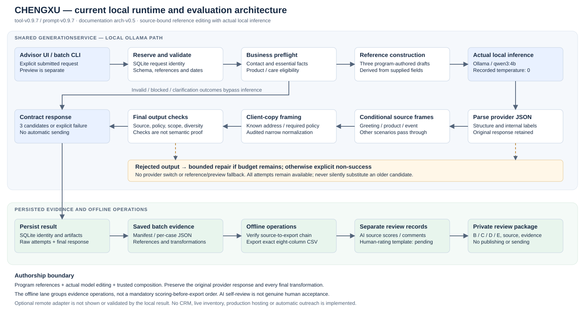
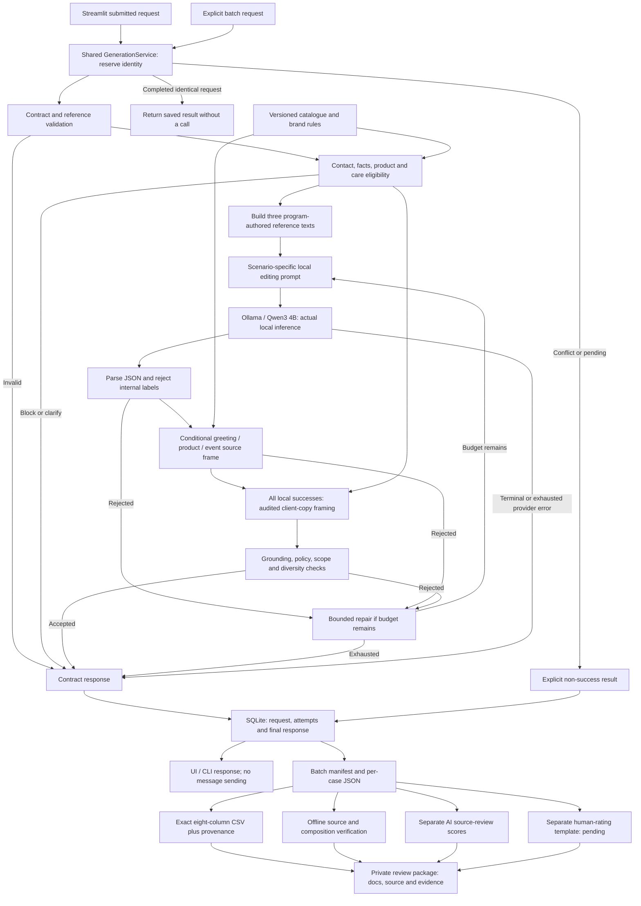

# Architecture — CHENGXU Client Advisor Tool

**Documentation revision: arch-v0.5. Measured implementation: tool-v0.9.7 / prompt-v0.9.7.** The diagram shows the active local path. Streamlit and the batch CLI share the same Python service; this is a local application, not a hosted production deployment.

The [standalone SVG](diagrams/architecture-v0.9.7.svg) opens without Mermaid support. The [Mermaid source](diagrams/architecture-v0.9.7.mmd) is editable. Both describe the same stages below; the SVG simplifies failure routing for readability.

## 1. Runtime and offline flow

The request store handles identity before inference. A reservation error stops execution. Final persistence failure suppresses candidate text and returns failure rather than an apparently saved success. The diagram omits low-level error edges; source behavior is defined by `GenerationService`.

## 2. Component map

| Component | Implemented responsibility | Main files |
| --- | --- | --- |
| Presentation | Six scenario forms, advanced JSON, explicit submission, selection/downloads | `app.py`; separate labelled `preview_service.py` |
| Orchestration | Reserve, validate, derive context, call provider, compose, check, save | `client_advisor/service.py` |
| Contracts / business preflight | Input shape/references/dates, contact precedence, product and service eligibility | `contracts.py`, `rules.py`, `context.py` under `client_advisor/` |
| Reference construction | Program-authored scenario copy from supplied facts; no case-ID lookup | `client_advisor/reference_drafts.py` |
| Active local prompt | Reference-editing task and bounded correction without rejected-output anchoring | `client_advisor/editorial.py`, routed by `prompts.py` |
| Provider | Actual loopback inference and sanitized error handling | `client_advisor/llm.py`, `config.py` |
| Conditional source frames | Occasion, eligible catalogue facts, event logistics/deadline | `greeting_composition.py`, `recommendation_composition.py`, `event_composition.py` |
| All-scenario client copy | Exact known address, missing mandatory refusal/prior-offer context, narrow normalization | `client_advisor/client_copy.py` |
| Output checks | Structure, selected claim/policy constraints, leakage and diversity proxies | `output_checks.py`, `source_checks.py`, `grounding.py` |
| Storage | SQLite identity reservations, completed artifacts and conflict events | `client_advisor/run_store.py` |
| Offline evidence | Saved-output evaluation/export, AI score aggregation and raw-to-final verification | `scripts/evaluate_cases.py`, `export_submission.py`, `summarize_ai_review.py`, `verify_quality_run.py` |

## 3. Trust boundaries and authorship

Operator-maintained catalogue/rules and structured purchase/event/contact fields are the supplied evidence. Client history is data, not authority to override a discount or contact restriction. Fictional fixture identifiers make the experiment traceable; they are not external authentication or proof that a source is true in production. No private brief or credential is sent as model context.

The model edits references for **all six scenarios**. Greetings, recommendations and invitations additionally receive program-generated source frames; care/reactivation/price do not use those three special frames, but still use references and the all-scenario client-copy step. Recommendation selection is deterministic first-eligible filtering, not LLM ranking. The [methodology](methodology.md) details the task split.

The service stores three distinct evidence layers:

| Layer | Saved fields |
| --- | --- |
| Program reference and actual input | `editorial_reference`, per-attempt `messages` |
| Raw provider result and conditional frame | Original `content`, validation errors, optional `structured_composition` |
| Client-copy and final response | `client_copy_composition` before/after/source additions, final candidate IDs/text |

References/frames do not create candidates after a failed provider call. Preview templates and fake adapters remain separate evidence kinds. The [integrity audit](verification/full-50-integrity-v0.9.7.json) reconstructs the entire saved text chain. It reports 98 reference-identical raw bodies and 75 client-copy transformations, so the final text must not be described as wholly model-authored prose.

## 4. Provider and failure behavior

The recorded local provider is Ollama qwen3:4b at a loopback HTTP endpoint, temperature 0, JSON output, no thinking, 16,384 context and 1,800 prediction limit. The configured attempt budget is two and timeout is 180 seconds per attempt. The final 50-case run needed one call per case; that is not a promise for future inputs. Local calls disable environment proxies and use no OpenAI credential.

Rejected output or retryable errors may consume the remaining budget. Unreachable local service, missing configuration/model or exhausted checks return explicit failure. No automatic switch to another provider or to preview/reference output occurs. The optional HTTPS OpenAI adapter is retained but follows a different prompt path; local quality results do not validate it.

| Contract status | Candidate count | Meaning |
| --- | ---: | --- |
| `generated` | 3 | Current application checks passed; advisor still reviews the messages |
| `needs_clarification` | 0 | Essential facts/permission need clarification |
| `blocked` | 0 | Applicable restriction prevents the request |
| `invalid_input` | 0 | Invalid contract or identity conflict |
| `generation_failed` | 0 | Provider, storage, pending reservation or exhausted-output failure |

## 5. Persistence and evaluation boundaries

Request identity includes input, public provider configuration, tool/prompt versions, catalogue/rule hashes and execution kind. Same completed identity replays the saved artifact; conflicting or pending identities do not launch a second inference. Intentional new runs need new request IDs. Local deduplication cannot guarantee provider-side exactly-once processing after a timeout.

The batch runner writes per-case JSON and a manifest in addition to SQLite. Offline scripts consume those artifacts rather than regenerate messages. AI scores and human-rating records are independent; an AI threshold pass never fills a human score. The current evaluation is self-review of a tuned set, as [D](evaluation-report.md) explains. The private package excludes credentials, the brief, model weights, runtime database and server logs.

## 6. Scope and verification

Recorded evidence is 87 regression tests, 20 zero-call guardrail cases and 44 isolated UI checks; [D](evaluation-report.md) links their artifacts and limits. Documentation consolidation does not rerun inference or change the frozen runtime. A temporary extraction can verify saved source/raw/composition/CSV linkage using installed dependencies; that is not a clean-machine installation or browser demonstration.

No separate HTTP application backend, vector database, CRM integration, automated sending or production hosting is implemented. Authentication, multi-user isolation, data retention, authorization and operational monitoring remain future production work. [E](defects-and-next-steps.md) separates those items from the current language-quality and submission gaps. The [historical architecture](history/pre-final-consolidation-v0.9.7/architecture.md) is retained only as a previous-version record.
