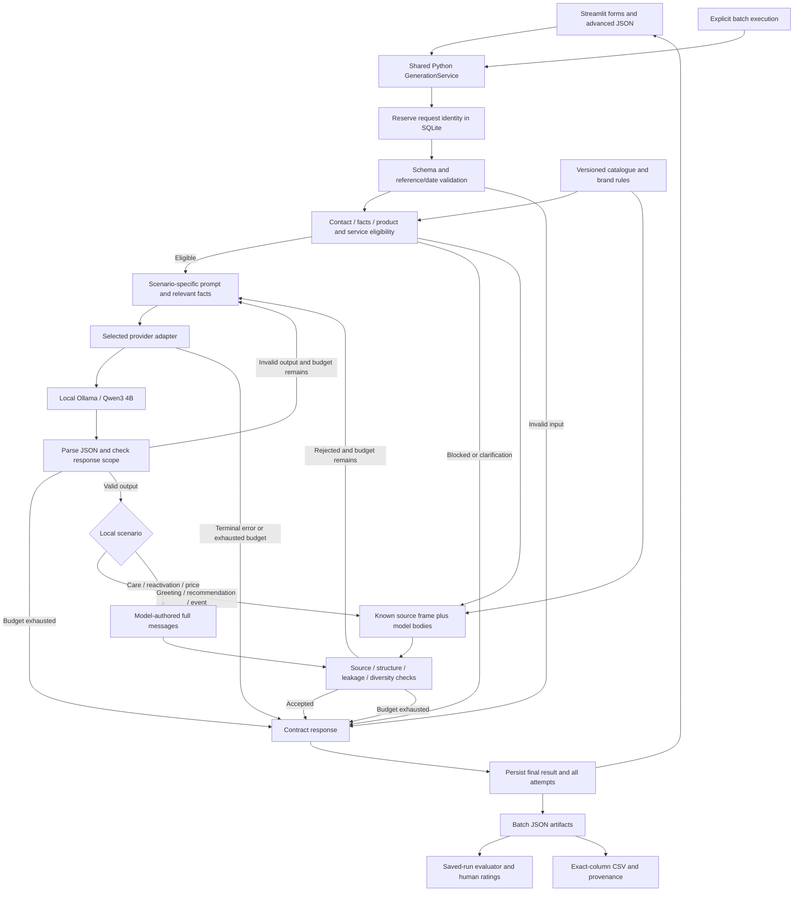

> Historical working draft. Superseded by the current documents under `docs/`. Relative evidence links have been adjusted for this archive location; recorded versions and outcomes have not been rewritten.

# Application Architecture — CHENGXU

## arch-v0.4 — current local pipeline

Tool/prompt-v0.9.7: 50/50 cases meet the stricter **AI-applied** case threshold, mean 4.31/5; genuine human review and release acceptance remain pending. [Detailed evidence and limitations](../../verification/ai-quality-review-v0.9.7/REPORT.md). The fixed 50-case dataset was actively used for tuning, so this is not holdout evidence.

All local requests now use program-authored evidence-bound reference copy edited by a real local LLM (98/150 raw bodies unchanged from reference). Greetings/products/events receive source frames; all local successes receive audited exact-address restoration, necessary policy/prior-offer context and narrow pronoun/typo normalization before grounding checks. Failed inference has no reference fallback. Every reference, raw provider output and transformation is retained. Source framing derives from fields, not case IDs. The same shared service powers UI and batch. Current freeze, full review and strict CLI replace the old deferred-work status.

Earlier sections below describe historical implementation/results and retain their recorded versions. Their thresholds and outcomes are not retroactively rewritten.


**Architecture revision: arch-v0.3**, November 5, 2026 (Asia/Shanghai). Describes the implemented **tool-v0.8.2 / prompt-v0.8.2**, with brand-v0.1, io-v0.1 and eval-v0.1. This is a local application architecture, not a production deployment claim.

## 1. System boundary

Streamlit and the batch CLI share one Python `GenerationService`. Business rules, catalogue resolution, model invocation, composition, validation and persistence live in that service rather than being duplicated in the UI. There is no separate HTTP application backend, vector database, CRM connection or message-sending service.



Cached, conflicting and pending reservations are handled before validation/inference; see section 6. Terminal parse failures follow the same bounded output-repair path as rejected candidates. The diagram summarizes runtime paths; it does not imply that every accepted draft is semantically correct.

## 2. Component responsibilities

Paths below are relative to the project root.

| Component | Responsibility | Main implementation |
| --- | --- | --- |
| Presentation | Scenario forms, submitted-result state, candidate selection and downloads; separate labelled preview | `app.py`, `preview_service.py` |
| Contracts | Strict request shape, references, dates and scenario consistency | `data/request.schema.json`, `client_advisor/contracts.py` |
| Context | One catalogue/rules baseline and recorded hashes | `data/catalogue.json`, `client_advisor/context.py`, `docs/brand-and-rules.md` |
| Business preflight | Contact precedence, essential facts, budget/carrying eligibility, care eligibility and event validity | `client_advisor/rules.py` |
| Orchestrator | Reservation, validation, provider call, bounded repair, result construction and persistence | `client_advisor/service.py` |
| Prompts and adapter | Relevant scenario task; actual local or optional remote inference | `client_advisor/prompts.py`, `client_advisor/llm.py`, `client_advisor/config.py` |
| Source-bound composition | Attach verified statements to model bodies in three local scenarios | `greeting_composition.py`, `recommendation_composition.py`, `event_composition.py` under `client_advisor/` |
| Output checks | JSON/counts, source heuristics, known leakage and diversity/review flags | `output_checks.py`, `source_checks.py`, `grounding.py` under `client_advisor/` |
| Durable run store | Request reservations, completed run artifacts and conflict events | `client_advisor/run_store.py`; local `runs/runs.sqlite3` |
| Offline evidence tools | Explicit generation, saved-run evaluation, CSV export and constrained recovery assembly | `scripts/generate_cases.py`, `evaluate_cases.py`, `export_submission.py`, `reconcile_recovery.py` |

SQLite is the shared local run store. The batch runner additionally saves JSON artifacts used by the evaluator/exporter. Streamlit session state holds the displayed submission/result; it is not the durable evidence store.

## 3. Trust and input boundaries

Operator-maintained brand/catalogue files establish approved product facts and policies. Structured case records identify relevant event, purchase and contact evidence. Client/history text describes what was said; it cannot authorize a discount or override contact rules. An advisor-role record and a customer claim about that advisor are different kinds of evidence.

The request schema rejects unknown fields; semantic checks resolve references and dates. Preflight screens explicit contact restrictions, unknown permissions, missing event facts, unsupported product constraints and applicable service conditions before inference. These language checks are intentionally limited, not an exhaustive consent or entailment system.

The advanced JSON interface is for the local operator. Fixture source IDs and hashes make controlled test evidence traceable; they are not authentication, external verification or a production provenance service. No runtime request includes the private challenge PDF or a provider key as model context.

## 4. Model task and composition modes

The following behavior describes the active **local** provider. The optional remote adapter uses its own full-draft prompt path and is not assumed equivalent.

| Scenario | Model task | Trusted composition |
| --- | --- | --- |
| Greeting | Three short wish bodies | Exact known address and birthday/festival opening |
| Recommendation | Three standalone preference questions | First eligible product's supported colour/price, a structure detail and dimensions |
| Invitation | Three invitation bodies | Known address, event title, local start date/time and venue |
| Care / reactivation / price | Three complete Chinese drafts | None; parsed full messages pass the same validation pipeline |

Recommendation selection takes the first `derived_context.eligible_product_ids` item. That filtering follows known budget/hard-use constraints; selection is not performed by the LLM and is not a ranking algorithm. Catalogue colour is not treated as live inventory.

Composition runs only after an actual model response parses successfully. Body-scope checks reject unsuitable content, including observed writing-instruction leakage. Non-success model statuses remain non-success; no frames are used to manufacture three messages after a failed call.

Each successful composition saves `structured_composition` with the method, `model_authored_bodies`, verified frame(s), source fields and `final_messages`. Recommendation metadata also identifies the selected product and selection rule. The original provider `content` remains unchanged in the attempt artifact.

Checks then inspect final messages. All successes contain candidate IDs 1–3 and exactly three Chinese messages. Soft length, suspicious-claim and naturalness flags invite review; they are not automatically verified hard failures. Regex and lexical checks do not establish full factual correctness or semantic diversity.

## 5. Provider configuration and retry behavior

The active adapter calls a loopback Ollama endpoint with JSON output mode, `stream=false`, `think=false`, context 16,384 and generation limit 1,800. It disables environment proxy use and sends no Authorization credential. Configuration validation restricts the local endpoint to loopback HTTP and rejects model tags ending in `:cloud`.

The retained remote adapter calls `/chat/completions` over HTTPS using a server-side credential and JSON-object response mode. No recommendation about current remote model availability is made here; the recorded full measurements use the local route. JSON mode is followed by application-side validation in both adapters.

| Setting or error | Local Ollama path | Retained remote path |
| --- | --- | --- |
| Current recorded timeout | 180 seconds per provider attempt | Default 45 seconds per attempt unless configured |
| Attempt budget | Default 2 total; configuration allows 1–3 | Same service budget |
| Rejected JSON/body/output | Repair within the configured budget | Repair within the configured budget |
| Transport reachability | `OLLAMA_UNREACHABLE` is terminal | Network errors are retryable within the budget |
| HTTP errors | Server errors are retryable; missing model is terminal | 429/server errors retryable; authentication/client errors terminal; allowlisted exhausted-credit codes terminal |

There is one HTTP call per service attempt and no separate automatic SDK retry layer. Generic repair can include the previous response plus validation errors. Local event and recommendation repair starts from the facts/task and errors to reduce anchoring on rejected wording; raw prior output is still stored. Greeting repair can include the previous body response.

Neither adapter switches model/provider or falls back to preview text. Exhausted or terminal failure returns `generation_failed` with zero candidates. Provider diagnostics use sanitized codes; raw provider error bodies and credential values are not written to the evidence artifacts. Normal output, prompt text, reported usage and timing are retained. Hidden reasoning is not requested as an evidence artifact.

## 6. Persistence, idempotency and failure states

A new request reserves its ID in SQLite **before** validation and inference. Identity covers the request, public provider configuration, tool/prompt versions, rules/catalogue hashes and execution kind (`live` or `test_double`).

| Reservation state | Behavior |
| --- | --- |
| New | Continue through validation/preflight/inference |
| Same ID, same identity, completed | Return saved artifact without a second provider call |
| Same ID, different identity | Return `invalid_input` with a conflict notice |
| Same ID and identity, pending | Return an explicit in-progress failure; do not issue a duplicate call |

An interrupted pending reservation requires an intentional new request ID. Completed runs are not silently overwritten through the normal service flow; this is application behavior rather than a tamper-proof database guarantee. Reservation failure prevents inference. Final persistence failure suppresses candidate text and reports failure instead of returning an apparently saved success.

This deduplication applies to the local shared store. A provider may have processed a request before a network timeout, so it does not guarantee exactly-once provider execution or billing.

| Contract status | Sendable candidates | Typical cause |
| --- | ---: | --- |
| `generated` | 3 | Current automatic checks passed; human review still required |
| `needs_clarification` | 0 | Missing/conflicting facts, unclear permission or model clarification |
| `blocked` | 0 | Applicable contact/event restrictions or model block |
| `invalid_input` | 0 | Invalid contract/references/dates or request identity conflict |
| `generation_failed` | 0 | Terminal provider/config/storage error, exhausted checks or pending reservation |

## 7. Stored evidence and offline workflow

A run artifact retains the original request, resolved products and derived context; public configuration and version/hash identity; each attempt's prompt, raw response or safe error code, validation errors, timing and reported usage; composition metadata when used; and the final contract response.

```text
Explicit batch generation
    -> saved per-case artifacts and batch manifest
    -> evaluation of saved text + separate human-rating file
    -> exact eight-column CSV and provenance
    -> source-linked report and private review package
```

The evaluator neither calls the model nor silently edits a candidate. It identifies its own implementation/source hashes so a later recheck of an older output is visibly retrospective. Fake-backed tests and preview templates are excluded from actual generation evidence. Missing human ratings remain pending.

A recovery assembly, if explicitly used, must include exactly every initially non-generated case, preserve facts/runtime identity and copy source bytes. It retains all selected recovery outcomes, including failure, rather than choose a stylistic best result. The current v0.8.2 full batch required no additional recovery; this behavior remains available for traceable failed-run handling.

## 8. Verification and deployment limits

The [recorded current verification](../../verification/source-repair-v0.8.2-regression-results.txt) covers contracts, policy boundaries, provider errors, retries, persistence/idempotency, UI paths, source composition and recovery provenance. Saved [integrity evidence](../../verification/full-50-integrity-v0.8.2.json) checks output/source consistency. These existing records are not newly executed by this architecture revision and do not establish language quality acceptance.

Current limitations include imperfect contact-language interpretation, incomplete source heuristics, predictable/question-heavy recommendations, generic wishes and unresolved care/price/event wording. Human scoring is incomplete and, at the user's direction, further case work is currently deferred. See the [evaluation report](../../evaluation-report.md) and [defect report](../../defects-and-next-steps.md).

The application is local-only. It has no implemented user authentication, multi-tenant isolation, CRM authorization, managed retention or production monitoring. A hosted demo would require a separate deployment decision and validation; none is implied by a localhost URL. Credentials, private brief, database, model weights and server logs are excluded from the existing review archive.

**Documentation scope:** arch-v0.3 and the consolidated methodology describe the current runtime without changing its code, prompts, catalogue, rubric or saved outputs. The UI demonstration/runbook and isolated verification are documented separately. A newly named documentation/UI review archive synchronizes them; the earlier ZIP remains a preserved historical snapshot. No current-case rerun or scoring is implied.
