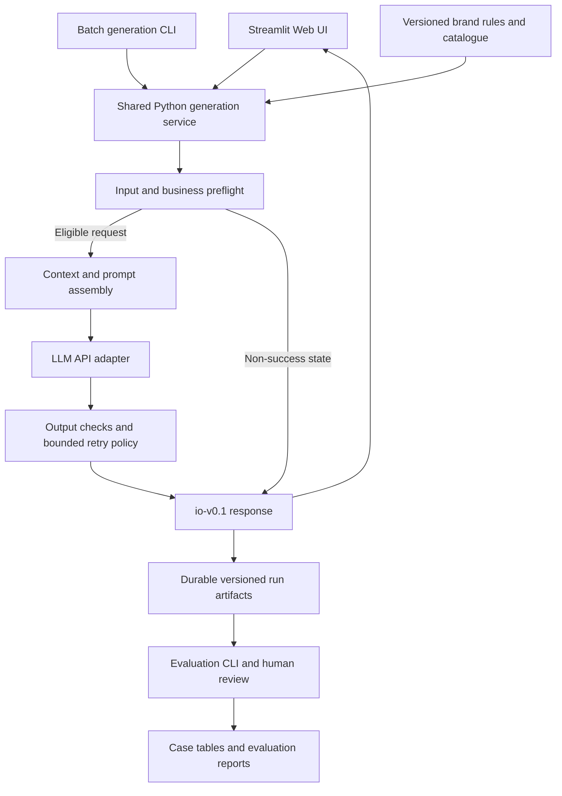

# Technical Direction — Streamlit and Shared Python Services

**Historical direction document.** The implemented system is described by [architecture arch-v0.3](architecture.md) and the [consolidated methodology](methodology.md), revised November 5, 2026. Proposed language below records the earlier design direction; it is not an outstanding task list. The current walkthrough/runbook and separately named documentation/UI package are complete; the user has deferred additional work on the existing 50 cases.


Decision version: **tech-v0.2**. The active implementation is tool-v0.3.3: Streamlit UI, shared Python generation service, **local Ollama adapter**, SQLite evidence store, and batch/evaluation/export scripts. OpenAI remains an optional adapter; the user chose not to buy API credits. The local model is installed and six scenario smoke cases have produced three messages each; human quality acceptance is pending. The [local-model guide](local-model.md) and refined [architecture](architecture.md) supersede the original sketch below.

## 1. Selected direction

Use **Streamlit for the Web UI**, a reusable **Python application service** for business logic, an **LLM API adapter** for generation, and **Python command-line scripts** for batch generation and evaluation. The UI and scripts call the same generation service and use [io-v0.1](input-output-spec.md) with [brand-v0.1](brand-and-rules.md).

The initial backend is an importable Python package running in the same process as Streamlit. A separate HTTP service is not required for the first version. Keeping the service independent of Streamlit allows later HTTP exposure if needed. Local Ollama with qwen3:4b is selected, using a 180-second configured request timeout and at most two attempts. The optional OpenAI path retains its own model settings. Direct dependencies are pinned. Deployment remains undecided.

## 2. Component responsibilities

| Component | Responsibility | Boundary |
| --- | --- | --- |
| Streamlit UI | Collect client/history/scenario fields, show relevant scenario controls, submit a request, display three candidate cards or an explicit non-success state, and allow result export. | No duplicated prompts, policy checks, or direct provider invocation in widget code. |
| Python application service | Validate and normalize requests, resolve trusted catalogue/context, enforce preflight rules, assemble prompts, invoke generation, validate outputs, and return the common response. | No imports from Streamlit; callable by both UI and command-line scripts. |
| LLM adapter | Handle provider-specific request/response conversion, credentials, timeouts, and API errors under a bounded invocation policy. | Provider responses are untrusted outputs until checked. Avoid overlapping SDK and service retries that multiply attempts. |
| Run recorder | Save request and resolved context snapshots, response, versions, attempts, and timing in durable run artifacts. | Session state is not the evidence store. Preserve original generated text and separate manual edits. |
| Batch generation script | Read case requests and call the same service without opening the UI; save each case outcome and support deliberate reruns. | No silent retries of already completed cases; a rerun gets new attempt/run records. |
| Evaluation script | Read saved results, apply deterministic checks and the future evaluation rubric, optionally invoke a separately identified model judge, and export per-case/aggregate results. | Evaluation does not silently regenerate or rewrite candidate text. Automated judgments remain separate from human review. |
| Report/export layer | Produce reviewer-friendly tables, including the brief's exact eight case columns, plus linked provenance. | Non-success guardrail results remain separate from the required 50 three-output generation cases. |

## 3. Preliminary flow



This is the original direction sketch. The current [architecture diagram and failure rules](architecture.md) provide the refined design.

## 4. Web UI behavior

The first interface should support the advisor's task directly:

1. Select one of six scenarios and optionally load a fictional example.
2. Enter/edit client information, contact preferences, and history; select catalogue products when relevant.
3. Fill only the scenario's applicable fields; event/purchase records come from controlled fixtures or operator-maintained data.
4. Submit explicitly to generate candidates.
5. Show three Chinese messages on success. Otherwise show the reason or missing fields addressed to the advisor, with no sendable placeholders.
6. Allow selection and export for CA review. Selection does not send a WeChat message. Keep technical provenance in a separate expandable area.

Use forms to batch field submission, rather than invoke the model for each field change. Streamlit documents that form values are sent to the backend together on submission. The scenario selector can sit outside the form so it can switch the applicable controls before submission. [Official forms guide](https://docs.streamlit.io/develop/concepts/architecture/forms).

Keep the last submitted request snapshot and corresponding response in per-session state. If inputs change, label the displayed result as belonging to the prior submitted request or clear it; do not present it as newly generated for the changed inputs. Only an explicit generation action should trigger a paid model call. Local persistence and request/run identifiers must guard against accidental repeated execution during UI reruns; cross-process deduplication details belong in the architecture.

Credentials are loaded server-side from environment/configuration, never embedded in source, exported transcripts, or client-facing messages. Do not place raw provider credentials in request snapshots. This project continues to use fictional client data and keeps the challenge brief private.

## 5. Automation and evaluation

Keep batch execution separate from interactive sessions. A planned workflow is:

```text
case request dataset
    → batch generation via shared service
    → preserved run artifacts
    → deterministic checks + rubric-based evaluation + human review
    → 50-case workbook and evaluation report
```

Record failures explicitly and preserve previous outputs when comparing versions. Guardrail checks should cover contact blocks, missing essential information, invalid input, and simulated provider errors. Model-quality evaluation requires actual model outputs and the next P1 acceptance rubric; fixtures are not substitutes for it.

Streamlit's `AppTest` can simulate an app and inspect its elements/state from Python, so targeted UI checks can later verify scenario switching, explicit submission, and result-state display without real model calls. This is a testing option, not a completed check or a replacement for evaluating message quality. [Official app-testing guide](https://docs.streamlit.io/develop/concepts/app-testing).

## 6. Proposed source layout

Implemented paths:

```text
app.py                         # Streamlit UI: template and real-provider modes
preview_service.py             # labelled offline templates
client_advisor/
  contracts.py                 # schema and reference/date checks
  context.py                   # shared catalogue and rules
  rules.py                     # business preflight
  prompts.py                   # prompt-v0.1
  service.py                   # shared generation service
  llm.py                       # Ollama/OpenAI adapters
  output_checks.py             # narrow automatic output checks
  run_store.py                 # SQLite reservation and evidence
  evaluation.py                # eval-v0.1 scoring
scripts/
  build_cases.py               # fictional input authoring
  generate_cases.py             # preflight or explicit paid execution
  evaluate_cases.py             # saved-run evaluation
  export_submission.py          # exact-column CSV/provenance
```

## 7. Remaining decisions

Acceptance criteria, the current architecture and test mapping exist, and the complete v0.8.2 measurement is preserved. Additional existing-case repair/reruns/scoring are deferred by user direction. The UI demonstration/runbook and separate documentation/UI package are now complete; final document/access review remains. No paid key is required for the active local path. No hosted deployment or publication has occurred.
